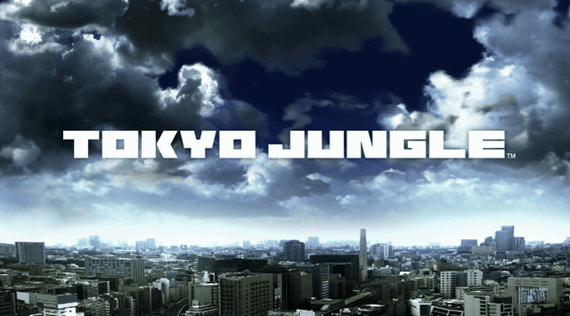
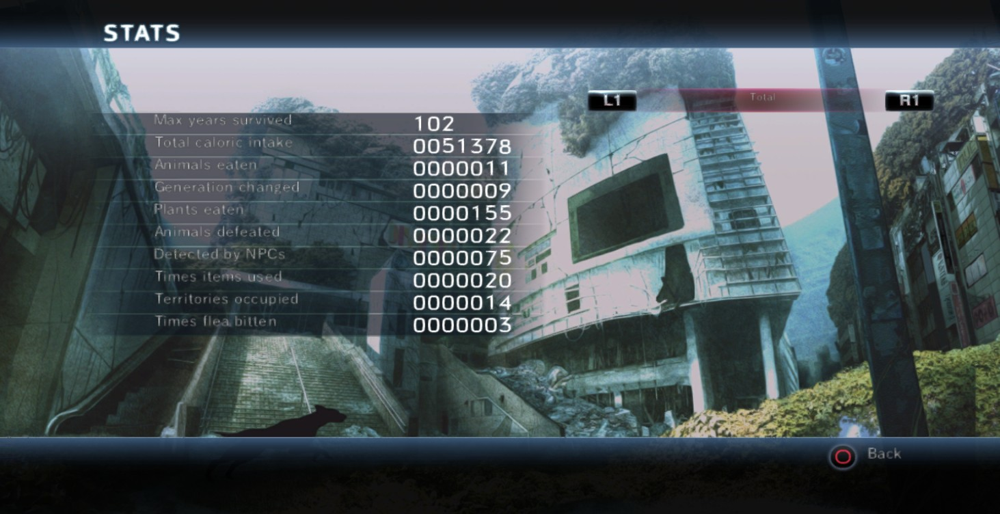
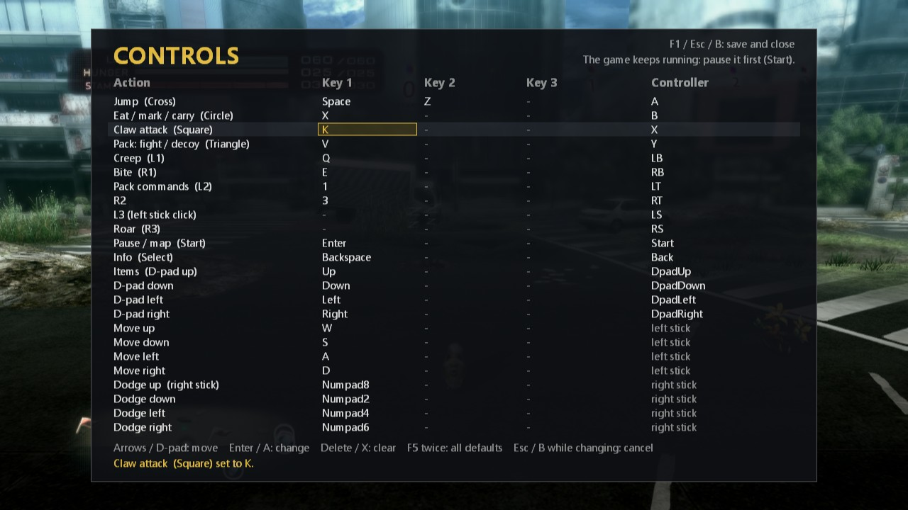

# Tokyo Jungle Recompiled



<sub>The title screen, live: recompiled PPU code, the game's own SPU workloads, and its RSX command stream on D3D12. No emulator.</sub>

**A Pomeranian walks into post-apocalyptic Tokyo. No, seriously.**

Tokyo Jungle (2012) is the most wonderfully absurd game Sony ever published — a survival action game where you play as animals fighting for dominance in a Tokyo abandoned by humanity. One moment you're a tiny Pomeranian sneaking past lions in Shibuya, the next you're a dinosaur asserting territorial control over Yoyogi Park. It's brutal. It's beautiful. It has no business being as good as it is.

And it's about to disappear.

## Why This Exists

Tokyo Jungle was a PS3 exclusive. The Western release was **digital-only** — no disc, no physical backup. Both of its developers are gone (Japan Studio dissolved 2021, Crispy's dormant since 2015). The PS3 store is running on fumes. Sony's PS Plus cloud streaming for PS3 titles has been [broken for months](https://www.playstationlifestyle.net/2026/01/18/ps3-game-streaming-busted-ps-plus-premium/). Nobody is coming to save this game.

So we're doing it ourselves.

**Tokyo Jungle Recompiled** is a native PC port built using [ps3recomp](https://github.com/sp00nznet/ps3recomp) — a static recompilation toolchain that translates PS3 PowerPC binaries into native C code, then compiles them as x86-64 executables. No emulation at runtime. No compatibility layers. Just raw, recompiled native code.

## Status: Playable. Survival Mode Runs at a Steady 30 FPS (October 2026)

> **A full 102-year Survival run has been played start to finish.** That was
> 2 hours 10 minutes of continuous hands-on play on 2026-10-14, at the game's native
> 30 FPS, with no crash, no freeze and no graphical glitches seen.



<sub>The game's own Stats screen after that run: <b>Max years survived: 102</b>.</sub>

The game boots to the title screen, menus, the animal select and into Survival,
and plays through normally. The HUD, map, menus and in-game saving all work.
The renderer now draws every frame the game sends, and the work since September
has been about making it **fast and stable for hours**.

### Play-tested

Every result here comes from someone actually playing the game, not from a script:

| Date | Session | Result |
|------|---------|--------|
| 2026-10-11 | Survival, busy areas | Map labels and text render correctly |
| 2026-10-12 | Survival, several runs | Menus and HUD fixed (they used to flicker or vanish) |
| 2026-10-13 | ~13 min Survival | 29-30 FPS in busy areas, no HUD loss, game saved normally |
| 2026-10-13 | ~22 min Survival | Exposed a rare command-ring deadlock (freeze), since fixed |
| 2026-10-13 | ~14 min full run | No freeze; game saved during play |
| **2026-10-14** | **2 h 10 min, 102 in-game years** | **30.0 FPS average, 99.7% of frames on time, no crash or freeze** |

Between the hands-on runs, every build was also checked with an automated hidden
run: boot, menus, into Survival, frame rate and error checks.

### Frame pacing (2-hour run, 2026-10-14)

| Measure | Result |
|---------|--------|
| Gameplay frames | 219,510 over 7,310 s |
| Average frame rate | **30.0 FPS** (the game's native rate) |
| Frames on time (37 ms or less) | **99.7%** |
| Frames over 45 ms | 21 in two hours (first-sight shaders, area loads) |
| Median / 99th percentile frame time | 33.3 ms / 35.7 ms |

The day before, the same measurement gave 27 FPS with 26-29% of frames late.

### Milestones

| Milestone | Status |
|-----------|--------|
| Binary analysis and PPU lifting | **Done**: 7,924 functions |
| SPU job images (SPURS) | **Done**: all 12 lifted and dispatched |
| Graphics (RSX → Direct3D 12) | **Done**: full rendering, HUD, map, menus, FXAA |
| Frame rate and pacing | **Done**: steady 30 FPS, including busy areas |
| Long-session stability | **Done**: 2 h 10 min with no freeze |
| Input and controls | **Done**: keyboard, mouse buttons and XInput controllers, all rebindable in game (F1) |
| Game data, fonts, movies | **Done** |
| Survival mode | **Playable**: full 102-year run |
| Saving | **Works** in play; reload across sessions being checked |
| Story mode | Being tested |
| DLC species | Not included in this repository |

### How it got here (September → October 2026)

- **Renderer.** Prefix replay with GPU ownership, plus early texture-label publication with a batch cap.
- **HUD.** 384 texture slots; the HUD used to vanish when 96 ran out.
- **Long-session freeze.** A 4096-entry vertex-shader cache with a hash index replaced a cache that filled up after about 13 minutes and froze the game.
- **Anti-aliasing.** The PS3's SPU MLAA job, the biggest single slowdown, is skipped and replaced by a host FXAA pass.
- **Shader hitches.** An on-disk shader cache and background shader compiling cut the worst first-sight hitch from 678 ms to 161 ms. Vertex conversion runs on 8 threads.
- **Command ring.** A libgcm-style FIFO recycle fixed a deadlock in very large frames.
- **Guest hot paths.** Environment checks that ran thousands of times a second are now cached. That removed almost all of the remaining late frames.
- **Window.** Alt no longer freezes the game, and closing the window ends the game cleanly, waiting for any save in progress.
- **PC controls.** An in-game Controls screen (F1) rebinds every key, mouse button and controller button.

The August-September development notes are kept in
[docs/HISTORY-2026-09.md](docs/HISTORY-2026-09.md). They cover the boot, the stalled
game-clock counter and the first frames.

### Still to check

- Story mode, chapter by chapter
- Save, quit and reload across sessions
- Other GPUs (all testing so far used one NVIDIA RTX-class PC)

## How It Works

```
PS3 ELF binary
    ↓ decrypt & parse
PPU PowerPC assembly
    ↓ disassemble & lift
Generated C source code (thousands of files)
    ↓ compile with MSVC/GCC/Clang
Native x86-64 executable
    + ps3recomp runtime (HLE OS services)
    + Graphics backend (RSX → D3D12)
    + Audio/Input backends
    ↓
Tokyo Jungle on your PC
```

The ps3recomp toolchain handles the heavy lifting of translating PowerPC instructions to equivalent C code. We provide game-specific configuration, function stubs, and fixes on top.

## Building

### Prerequisites

- **CMake** 3.20+ and **Ninja**
- **clang-cl** (LLVM) with the MSVC 2022 build tools (Windows, Direct3D 12)
- **Python** 3.10+ with packages: `pycryptodome`, `capstone`, `construct`, `tabulate`, `tomli`, `tqdm`
- **ps3recomp** at [sp00nznet/ps3recomp](https://github.com/sp00nznet/ps3recomp) commit `d7fff845`, with
  [`patches/ps3recomp`](patches/ps3recomp/README.md) applied, checked out next to this folder
- **A legitimate copy of Tokyo Jungle** (NPUA80523 / BCAS20219). You must legally own the game

### Steps

```bash
git clone https://github.com/LasVola/tokyojungle.git
git clone https://github.com/sp00nznet/ps3recomp.git
cd ps3recomp && git checkout d7fff845aca42b5083791801a01d150f5f0ec18c
git apply ../tokyojungle/patches/ps3recomp/ps3recomp-tokyojungle-2026-10-14.patch
cd ../tokyojungle
pip install -r requirements.txt

# Your own decrypted ELF and PARAM.SFO
cp /path/to/your/EBOOT.ELF /path/to/your/PARAM.SFO input/

python scripts/analyze.py        # function discovery + lifting
python scripts/gen_stubs.py      # stubs and dispatch table
python scripts/post_lift.py      # post-lift repairs (vector fixes, MLAA skip hook, ...)

cmake -B build-clang -G Ninja -DCMAKE_BUILD_TYPE=Release -DCMAKE_C_COMPILER=clang-cl -DCMAKE_CXX_COMPILER=clang-cl
cmake --build build-clang --config Release
```

### Running

```powershell
powershell -File scripts\launch_tokyojungle.ps1 -Run -Recommended -GameData <folder with your extracted game (USRDIR, PARAM.SFO)>
```

`-Recommended` turns on every setting used for the tested runs above: FXAA instead of
SPU MLAA, early texture labels, lookup fast paths, 8 vertex threads and background
shader compiling. Saves go to `savedata/`, the shader cache to `shader-cache/`, and
logs to `run-logs/` (the 10 newest are kept).

### Controls

Press **F1** in game (or **Back + Start** on a controller) to open the Controls screen:

- **Arrows** or D-pad pick an action. Each row says what it does in the game.
- **Enter** or A changes it: press the new key, mouse button or controller button.
- **Delete** or X clears it, and **F5** twice restores the defaults.
- **F1, Esc or B** saves and closes. Changes apply at once and are stored in `controls.ini`.



| Action | Keyboard (default) | Controller |
|--------|--------------------|------------|
| Move | W A S D | Left stick |
| Dodge | Numpad 8 / 2 / 4 / 6 | Right stick |
| Jump (Cross) | Space or Z | A |
| Eat / mark / carry (Circle) | X | B |
| Claw attack (Square) | C | X |
| Pack: fight / decoy (Triangle) | V | Y |
| Creep (L1) / Bite (R1) | Q / E | LB / RB |
| Pack commands (L2) / R2 | 1 / 3 | LT / RT |
| Pause / map (Start) / Info (Select) | Enter / Backspace | Start / Back |
| Items (D-pad up), D-pad | Arrow keys | D-pad |

`scripts/controls_editor.ps1` edits the same file outside the game.

**To quit,** close the window (X or Alt+F4). A save in progress finishes first.

> **Note:** You must supply your own legally obtained game files. This project does
> not include, distribute, or link to any copyrighted game data.

## Game IDs

| Region | ID | Format |
|--------|----|--------|
| NA (Digital) | NPUA80523 | PSN |
| JP (Disc) | BCAS20219 | Blu-ray |
| EU (Digital) | NPEA00421 | PSN |

## Project Structure

```
tokyojungle/
├── src/
│   ├── main.cpp                # Entry point, VM init, ELF loading, HLE registration
│   ├── tj_present.cpp          # Present loop: vblank cadence, flips, FIFO drain, clean exit
│   ├── tj_crt_overrides.cpp    # Game-specific overrides (MLAA skip, SPU task signals, ...)
│   ├── tj_pamf_media.cpp       # PAMF movie playback
│   ├── tj_gcm_interrupt.cpp    # GCM interrupt worker
│   ├── stubs.cpp, recomp_bridge.h, import_resolver.h, hle_imports.h, elf_loader.h
│   └── gen/                    # HLE NID table, SPU workload registry
├── scripts/
│   ├── analyze.py, gen_stubs.py  # Lifting pipeline
│   ├── post_lift.py              # Post-lift repairs and hooks
│   └── launch_tokyojungle.ps1    # Launcher with the -Recommended preset
├── patches/ps3recomp/          # Runtime changes as one patch against ps3recomp
├── tests/                      # Native and Python unit tests
├── input/                      # Your game files go here (gitignored)
├── generated/                  # Recompiled C++ output (gitignored)
└── docs/                       # Progress notes and development history
```

## Contributing

Help is very welcome. The most useful things now:

- **Story mode testing.** Play through chapters and report anything that breaks.
- **Other hardware.** Run it on other GPUs (AMD, Intel) and report frame pacing.
- **Save/reload checks** across many sessions.
- **Code review** of the renderer and runtime patch (`patches/ps3recomp`).

If you've worked with PS3 internals, RPCS3, N64Recomp, or similar recompilation
projects, your expertise would be invaluable.

## Credits

- **[sp00nznet](https://github.com/sp00nznet)**: the original port and
  [ps3recomp](https://github.com/sp00nznet/ps3recomp)
- **This fork (August–October 2026)**: renderer, pacing and stability work done with
  Codex and Claude Code, play-tested by LasVola

## License

The code in this repository is MIT licensed — see [LICENSE](LICENSE). That covers
*our* code only: the port scaffold, HLE glue, and build scripts. It does not and
cannot cover Tokyo Jungle itself, and no game data is included here.

## Legal

This project is a clean-room recompilation toolchain output. It does not contain any proprietary Sony or game code. You must provide your own legally obtained game files. This project exists solely for game preservation purposes.

**Tokyo Jungle** is a trademark of Sony Interactive Entertainment. This project is not affiliated with, endorsed by, or connected to Sony, Japan Studio, or Crispy's in any way.

## A Love Letter

Tokyo Jungle is one of those rare games that could only exist because someone at Sony said "sure, why not" to a pitch about a Pomeranian surviving the apocalypse. It's weird. It's wonderful. It sold over 500,000 copies. It got a perfect score from Famitsu. And in a few years, without intervention, it will exist only in YouTube videos and fond memories.

Games like this don't deserve to vanish just because the hardware they ran on becomes obsolete. If you've ever watched a golden retriever take down a crocodile in the streets of Shibuya, you know exactly why this project exists.

**Let's keep Tokyo Jungle alive.**

---

*Built with [ps3recomp](https://github.com/sp00nznet/ps3recomp) | Star this repo if you want to pet the Pomeranian*
